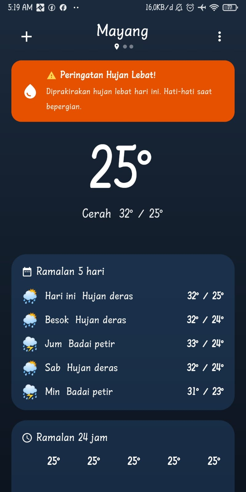
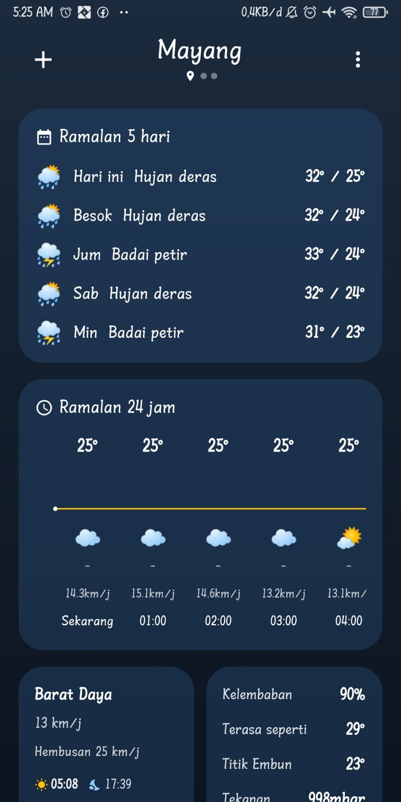
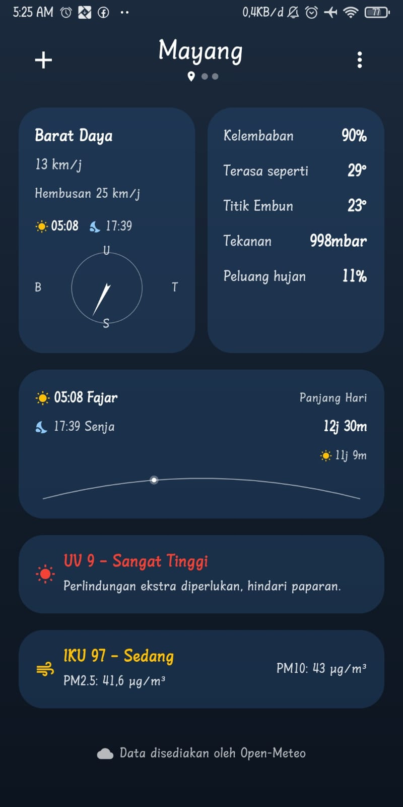
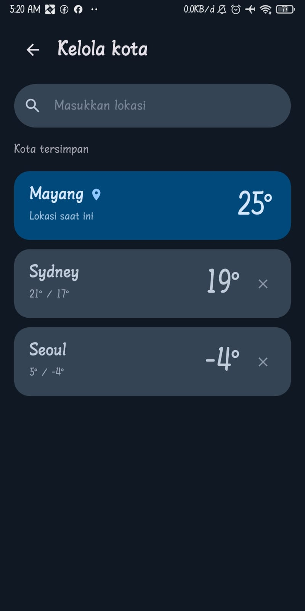

# DayNight Weather App

DayNight adalah aplikasi cuaca modern berbasis Android yang dikembangkan menggunakan **Jetpack Compose** dan **Material 3**. Aplikasi ini menyediakan informasi prakiraan cuaca real-time, indeks kualitas udara, grafik interaktif, serta pengelolaan banyak kota menggunakan Open-Meteo API.

---

## Fitur Utama

- **Navigasi Geser Banyak Kota (HorizontalPager)**:
  - Memuat lokasi GPS saat ini secara otomatis sebagai Halaman Utama (Lokasi Saat Ini).
  - Geser ke kiri dan kanan untuk melihat cuaca di kota-kota lain yang telah ditambahkan.
  - Indikator halaman dinamis pada bagian header.

- **Pencarian Kota dan Daerah**:
  - Cari lokasi atau kota di seluruh dunia dengan saran referensi pencarian secara real-time.
  - Tambahkan kota dengan mudah menggunakan tombol tambah pada daftar referensi.
  - Lokasi saat ini dikunci dan dilindungi agar tidak terhapus.

- **Informasi Cuaca Komprehensif**:
  - **Bagian Utama**: Suhu saat ini, deskripsi cuaca, serta suhu maksimum dan minimum harian.
  - **Ramalan 5 Hari**: Kartu prakiraan harian yang ringkas dan jelas.
  - **Grafik Ramalan 24 Jam**: Grafik kurva suhu interaktif lengkap dengan ikon cuaca, kecepatan angin, dan curah hujan dalam milimeter.
  - **Kompas Angin & Fajar/Senja**: Informasi arah mata angin, kecepatan hembusan, serta waktu fajar dan senja.
  - **Detail Tambahan**: Kelembapan, terasa seperti, titik embun, tekanan udara, dan peluang hujan.
  - **Indeks UV & Kualitas Udara (IKU)**: Pemantauan IKU, PM2.5, PM10, dan tingkat perlindungan UV.
  - **Peringatan Dini Cuaca Ekstrem**: Banner peringatan otomatis untuk hujan lebat dan badai petir.

- **Pengaturan & Kustomisasi**:
  - **Tema Tampilan**: Pilihan Mode Terang, Mode Gelap, atau mengikuti pengaturan Sistem.
  - **Bahasa**: Tersedia dalam Bahasa Indonesia dan Bahasa Inggris.
  - **Tarik untuk Memperbarui (Pull-to-Refresh)**: Perbarui data cuaca dengan mudah di setiap halaman kota.

---

## Tangkapan Layar (Screenshots)

| Halaman Utama (Beranda) | Grafik Cuaca 24 Jam | Rincian & Kompas Angin | Kelola Kota & Pencarian |
| :---: | :---: | :---: | :---: |
|  |  |  |  |

---

## Teknologi dan Arsitektur

- **Antarmuka (UI)**: Jetpack Compose & Material 3
- **Arsitektur**: MVVM (Model-View-ViewModel) dengan Kotlin Coroutines & StateFlow
- **Jaringan**: Retrofit & Gson
- **API Cuaca**: Open-Meteo Weather, Air Quality, & Geocoding API
- **Lokasi**: Google Play Services Location & Android Geocoder
- **Penyimpanan**: SharedPreferences & DataStore Preferences

---

## Cara Menjalankan Proyek

1. Clone repositori ini atau buka folder proyek melalui **Android Studio**.
2. Lakukan sinkronisasi dependensi Gradle (`File > Sync Project with Gradle Files`).
3. Jalankan aplikasi pada Emulator Android atau perangkat fisik (Android 8.0 / API level 26 ke atas).
